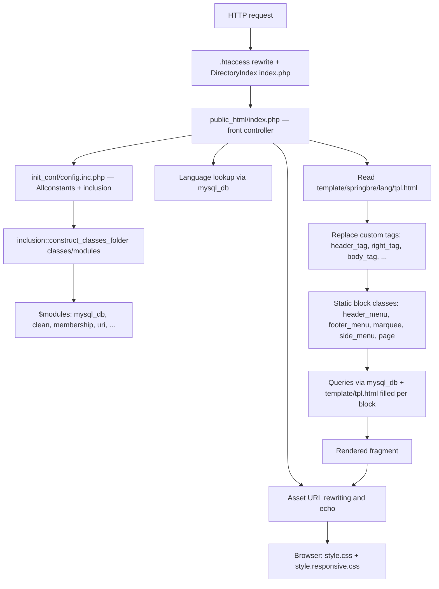
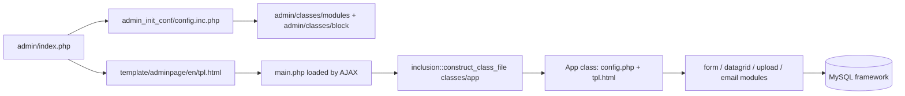
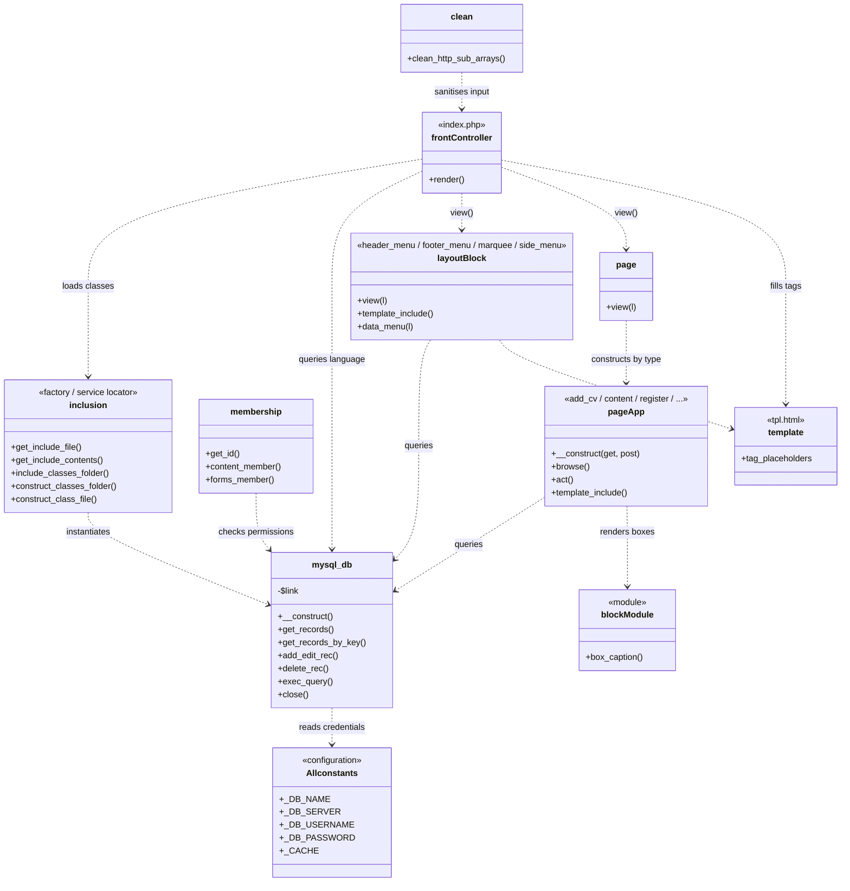

# Abdoun CMS

A small, database-driven CMS built in procedural-era PHP 5.6 and containerized with Docker. Content, languages, menus, forms, members and votes live in MySQL; presentation is assembled from folder-based PHP *modules* and *blocks* plus HTML templates with tag placeholders.

The public site is bilingual (English / Arabic) and uses the `springbre` Artisteer-derived template, now extended with a responsive layer.

## Stack

| Component | Version / detail |
| --- | --- |
| Web | PHP 5.6 + Apache 2 (`php:5.6-apache`) |
| Database | MySQL 5.7 (`mysql:5.7`), database `framework` |
| Extensions | `mcrypt`, short open tags (`<?`), `mysql_*` API |
| Front end | XHTML templates, jQuery, CSS (`style.css` + `style.responsive.css`) |
| Admin | `/admin`, HTML frames loaded through AJAX |

## Run

```bash
docker-compose up -d --build
```

Open: <http://localhost:8085>

## Services

| Service | Image / build | Host port | Container port |
| --- | --- | --- | --- |
| `web` | `build: .` (Dockerfile) | `8085` | `80` |
| `db` | `mysql:5.7` | — (exposed in earlier revisions) | `3306` |

Both services use `restart: unless-stopped`. MySQL `root` password is `root`; the container exposes the `framework` database.

## Database

On first run, `admin_init_conf/framework.sql` is imported automatically into `framework` with UTF-8 (`mysql-utf8.cnf`). The schema contains:

`answers`, `comments`, `contacts`, `content`, `countries`, `forms`, `groups`, `groups_forms`, `groups_members`, `groups_news`, `languages`, `members`, `news`, `news_type`, `newsletter`, `questions`, `results`, `search_words`, `search_words_old`, `send_mail`, `sessions`, `towns`, `users`, `vote`.

The `content` table is the hub: its `type`, `parent`, `permission`, `header_menu`, `marquee`, `enabled`, `ordered` and `language` fields decide which page app renders a record and where it appears in menus.

## Repository layout

```text
.
├── docker-compose.yml, Dockerfile, mysql-utf8.cnf
├── init_conf/config.inc.php          # front-end bootstrap: Allconstants + inclusion
├── admin_init_conf/                  # admin bootstrap + SQL seed
└── public_html/
    ├── index.php                     # public front controller
    ├── rss.php, sitemap.xml, image.php
    ├── admin/
    │   ├── index.php, main.php       # admin shell + AJAX content loader
    │   ├── classes/{app,modules,block}/
    │   └── template/adminpage/{en,ar}/
    ├── classes/
    │   ├── modules/                  # reusable service classes (one folder per class)
    │   └── block/                    # page composition blocks
    │       ├── header_menu, footer_menu, marquee, controls
    │       ├── page/                 # public page apps
    │       └── side_menu/parts/      # sidebar widgets
    ├── language/                     # language packs
    └── template/springbre/
        ├── en/, ar/                  # tpl.html, style.css, style.responsive.css, images
        └── index.*                   # original Artisteer previews
```

## Request lifecycle (OOP view)



### Admin request lifecycle



## Object model

The codebase predates Composer and PSR autoloading. Classes are discovered **by folder convention** and loaded by the `inclusion` utility rather than by an autoloader.



Key conventions:

- **Front controller** — `public_html/index.php` handles every public request, resolves the language, renders the template and echoes the final HTML. `admin/index.php` plays the same role for the admin area.
- **Convention over configuration** — `inclusion::include_classes_folder()` does `require_once <folder>/<name>/<name>.php`; `construct_classes_folder()` additionally instantiates each class into `$modules`. An app is selected from `$_GET['type']`.
- **Template method style** — block and app classes expose `template_include()`, `get_url()`, `browse()` and `act()`; they read a `template/tpl.html` and replace `<tag />`, `<title_ />` etc.
- **Static utilities** — most helpers (`clean`, `uri`, `validate`, `crypt`, `js`, `email`, `form`, `mysql_db` in the public flow) are called statically.
- **Thin inheritance** — inheritance is rare; the notable case is `keywords_related extends keywords_menu`.
- **No ORM / no autoloader** — `mysql_db` is a hand-written wrapper over the legacy `mysql_*` API and exposes `get_records*`, `add_edit_rec`, `delete_rec`, `exec_query`.

## Modules

Reusable classes under `public_html/classes/modules/` (each folder holds `config.php`, `<name>.php` and a `template/` where relevant). The admin has its own copy under `public_html/admin/classes/modules/`.

| Module | Responsibility |
| --- | --- |
| `mysql_db` | MySQL connection (UTF-8), select/insert/update/delete helpers |
| `clean` | Request sanitising (`clean_http_sub_arrays`, `burn`) |
| `validate` | Field validation (`verify`) |
| `crypt`, `crypt_aes` | Encryption helpers (mcrypt / MySQL `AES_ENCRYPT`) |
| `upload` | File upload handling |
| `form` | HTML form building helpers |
| `datagrid` | Data-grid rendering helper |
| `block_` | Artisteer-style block/box markup (`box_caption`) |
| `box` | Redirect / alert box helpers |
| `email` | Sending mail, optionally with an attachment |
| `embed` | Normalising embedded media URLs |
| `js` | JavaScript tag output |
| `uri` | URL/query-string rewriting helpers |
| `membership` | Member and content/form permission checks |

Admin-only modules: `perm` (permission checks) plus admin copies of the shared helpers.

## Blocks

### Layout blocks (`public_html/classes/block/`)

| Block | Role |
| --- | --- |
| `header_menu` | Horizontal language/content menu (`<header_tag />`) |
| `footer_menu` | Footer links and copyright (`<footer_tag />`) |
| `marquee` | News ticker above the content (`<marquee_tag />`) |
| `side_menu` | Sidebar container (`<right_tag />`) that assembles the parts below |
| `page` | Renders the main `<body_tag />` by dispatching to a page app |
| `controls` | Rating and other form actions |

### Sidebar parts (`classes/block/side_menu/parts/`)

`ads`, `facebook`, `followus`, `keywords_menu`, `last_articles`, `login`, `main_menu`, `most_articles_hits`, `participate`, `search`, `search_old`, `vote`.

### Page apps (`classes/block/page/app/`)

`add_cv`, `buy_online`, `contactus`, `content`, `investors`, `join`, `map`, `news_map`, `questionair`, `register`, `rss_`, `search_result`, `view_results`.

### Admin blocks and apps

Admin layout blocks: `footer_menu`, `header_menu`, `languages_menu`, `tree_menu`.

Admin apps under `public_html/admin/classes/app/`: `answers`, `build_sitemap`, `comments`, `contacts`, `content`, `countries`, `forms`, `groups`, `groups_forms`, `groups_members`, `groups_news`, `languages`, `login_email`, `members`, `newsletter`, `news_type`, `questions`, `results`, `search_words`, `send_mail`, `sessions`, `side_bar_control`, `signout`, `towns`, `user_area`, `users`, `vote`.

Each admin app follows the same pattern: `config.php` (metadata/order), `<app>.php` (class), `template/tpl.html` (markup).

## Theming

`template/springbre/{en,ar}/` contains the front-end theme:

- `tpl.html` — page skeleton with custom tags (`<header_tag />`, `<right_tag />`, `<body_tag />`, `<footer_tag />`, `<marquee_tag />`).
- `style.css` — original fixed-width (1100px) Artisteer stylesheet.
- `style.responsive.css` — responsive layer (fluid canvas, 980/760/480px breakpoints, mobile menu, fluid news ticker). The filename starts with `style.` so `index.php` rewrites it to an absolute URL with the same rule used for `style.css`.
- `images/header-banner.jpg` — text-free header artwork used by both languages; the original `icon.png` is layered on top of it (left in English, right in Arabic).

Branch `en` is LTR and `ar` is RTL; the Arabic stylesheet overrides alignment, floats and submenu borders. The admin area follows the same approach: `admin/template/adminpage/{en,ar}/tpl.html` plus the responsive rules appended to `style.css` (the copy at `admin/template/adminpage/style.css` is used on the first visit, before the language cookie is set). `admin/index.php` selects both the template and the assets from the session language, so switching language takes effect on the same request. Most admin apps have hardcoded Arabic UI strings; `admin/language/translations.en.php` maps those phrases to English and is applied by `admin/index.php` and `admin/main.php` when the English language is active. Content stored in the database (for example Arabic article titles) is left untouched. The English and first-visit stylesheets also override the original RTL-oriented text alignment so `l=en` renders left-aligned.

## Demo notice / cookie consent

A bilingual demo notice (English and Arabic) is injected through the
`<privacy_tag />` placeholder at the end of both `template/springbre/{en,ar}/tpl.html`
files. The notice is built by `classes/block/privacy/privacy.php` from the
`_PRIVACY_*` constants in `language/{en,ar}.php`. It states that the app is now a
**demo** and warns visitors **not to enter or submit any real, personal or
confidential data through the site's forms - use fictional test data only**.

- On first visit the overlay is shown; it is hidden by default, so browsers with
  JavaScript disabled are unaffected.
- Clicking **OK** stores `abdoun_privacy=1` in a browser cookie (one year, `path=/`,
  `SameSite=Lax`) and hides the dialog.
- A small **Demo / Privacy** / **تجريبي / خصوصية** tab remains at the bottom corner
  so the notice can be reopened at any time.
- The replacement runs last in both `index.php` and `backup.php` so the global
  `images` / `style.` URL rewrites do not touch the inline CSS and JavaScript.

## Notes

- Despite `public_html/index.php` being the documented front controller,
  `public_html/.htaccess` rewrites `index.php` to `backup.php`; the live site is
  therefore served by `backup.php`. Keep shared changes in sync in both files.
- PHP short open tags are enabled and required by the source files.
- The application uses the deprecated `mysql_*` extension (PHP 5.6) and unescaped SQL in places; treat it as legacy code.
- Files named `* - Copy.php`, `*_old.php` and `backup*.php` are historical copies kept in the tree.
- `docker-compose.yml` mounts the working directory into `/var/www/html`, so template edits are live without rebuilding.
- The admin **Sitemap** app writes `public_html/sitemap.xml`. URLs are built from the request host (including the port, e.g. `http://localhost:8085/`), without a forced `www.` prefix. `docker-compose.yml` makes the file writable for Apache at container startup so generation works from a fresh checkout.
